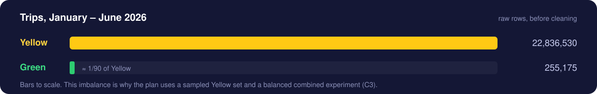

<div align="center">


<br/>


**How long will this ride take, and what will it cost?**
A two-stage machine learning pipeline over the full **2025** NYC TLC trip records:
predict trip duration from what is known when the taxi is hailed, then predict the
fare using that predicted duration.

[Status](#status) · [Pipeline](#pipeline) · [Data](#data) · [No peeking](#no-peeking-at-the-future) · [Quickstart](#quickstart)

</div>

---

## What the project predicts

| Stage | Target | Inputs | Output |
|:--:|---|---|---|
| **1** | `duration_min` | pickup time, pickup and drop-off zone, taxi type, geometry, weather, holiday flags, leakage-safe route history | minutes |
| **2** | `fare_amount` | everything in stage 1 **plus the stage-1 duration prediction** and historical fare aggregates | USD |

The application will return the predicted duration, the predicted fare, the estimated arrival time and a
prediction interval, using only information available **before** the trip starts.

## Status

| Phase | Deliverable | State |
|:--:|---|---|
| 0 | Repository audit, decisions, progress log (`docs/`) | complete |
| 1 | Source verification, feature contract, split plan | complete |
| 2 | 2025 ingestion, cleaning, geospatial/weather integration, audit notebook, tests | complete |
| 3 | Exploratory data analysis (notebook `02`) | complete |
| 4 | Feature engineering + leakage-safe history (notebook `03`) | complete |
| 5 | Duration and fare models (notebooks `04`, `05`) | next |
| 6 | Evaluation, SHAP explainability (notebook `06`) | pending |
| 7 | End-to-end demo, Streamlit app (notebook `07`, `app/`) | pending |

## Pipeline


External inputs — the TLC zone lookup and shapefile, hourly weather, and the holiday calendar — enter
at step 03, together with the leakage-safe route history built from earlier months only.

## Data

Official [TLC Trip Record Data](https://www.nyc.gov/site/tlc/about/tlc-trip-record-data.page) for
calendar year **2025**, Yellow and Green taxis:

| | Yellow | Green | Total |
|---|---:|---:|---:|
| Raw rows (Jan–Dec 2025) | 48,722,602 | 591,375 | 49,313,977 |
| Used for modelling | 44,511,782 (91.4%) | 559,224 (94.6%) | 45,071,006 |

Plus the TLC zone lookup and shapefile, hourly weather for Central Park from the Open-Meteo
archive, and the 2025 US federal and New York State holiday calendars. Standard FHV records are
excluded because they lack the pickup/drop-off and fare fields this task needs.

Every monthly file is downloaded by a restartable script that validates the Parquet footer, records a
SHA-256 and row count in `data/raw/manifest_2025.json`, and skips files that are already valid.
Nothing is assumed about availability: all 24 files were verified live before the pipeline was written.

## Two very different fleets



Yellow outnumbers Green by roughly **80 to 1** and concentrates in Manhattan and at the airports.
Green cabs (Boro Taxis) cannot take street hails in most of Manhattan and mostly serve the outer
boroughs, which is why every result in this project is reported per taxi type rather than pooled.

## No peeking at the future

| Allowed before the trip | Excluded (only known after it) |
|---|---|
| Pickup hour, day, month, weekend, rush hour, holiday | Drop-off timestamp, actual duration |
| Pickup & drop-off zone, borough, zone centroids | Metered `trip_distance` |
| Haversine and grid distance from zone geometry | `fare_amount`, `tip_amount`, `total_amount` |
| Weather at the pickup hour, taxi type | Tolls, surcharges, `congestion_surcharge`, `cbd_congestion_fee` |
| Route/zone history built from **earlier months only** | `RatecodeID`, `payment_type`, `store_and_fwd_flag` |

Two consequences worth stating plainly: expected duration accuracy is modest, because the model
never sees the route actually driven; and fare predictions must combine a metered fare estimate with
history, because tips and tolls are unknowable in advance.

## Repository layout

```text
nyc-taxi-ml/
├── assets/                   README graphics (protected)
├── data/
│   ├── raw/                  monthly TLC Parquet + manifest + zone lookup (git-ignored)
│   ├── external/             weather, holidays, zone centroids, shapefile
│   └── processed/            cleaned dataset, feature table, cleaning audit
├── notebooks/                01 audit · 02 EDA · 03 features · 04 duration
│                             05 fare · 06 evaluation · 07 end-to-end
├── src/
│   ├── ingestion/            download_tlc.py, download_external.py
│   ├── preprocessing/        build_clean_dataset.py
│   ├── features/             build_features.py
│   ├── models/               (planned) training for stages 1 and 2
│   ├── evaluation/           (planned) metrics and reports
│   └── serving/              (planned) shared inference path for the app
├── app/                      (planned) Streamlit application
├── tests/                    integration checks over the built artefacts
├── tools/                    reproducible notebook builders
├── docs/                     audit, plan, decisions, progress log, data dictionary
└── reports/                  (planned) figures and metrics tables
```

## Quickstart

Requires [uv](https://docs.astral.sh/uv/).

```bash
git clone https://github.com/Shreyit/nyc-taxi-ml.git
cd nyc-taxi-ml
uv sync

# 1. download and validate the 24 monthly files, zone data, weather and holidays
uv run python -m src.ingestion.download_tlc
uv run python -m src.ingestion.download_external

# 2. build the cleaned dataset and the feature table (DuckDB, ~7 minutes)
uv run python -m src.preprocessing.build_clean_dataset
uv run python -m src.features.build_features

# 3. checks
uv run pytest -q
```

Then open the notebooks in order and run them top to bottom. Select the project's `.venv`
interpreter and the `nyc-taxi-ml` Jupyter kernel.

## Documentation

| File | Contents |
|---|---|
| [`docs/project_audit.md`](docs/project_audit.md) | What existed before this cycle, and what was reused, refactored or replaced |
| [`docs/project_plan.md`](docs/project_plan.md) | Source verification, split, feature contract, modelling plan, risks |
| [`docs/decisions.md`](docs/decisions.md) | Technical decision records, including rejected alternatives |
| [`docs/data_dictionary.md`](docs/data_dictionary.md) | Every column of every table, raw and processed |
| [`docs/progress_log.md`](docs/progress_log.md) | What was run, and what was actually verified |

## Responsible use

TLC records are public and de-identified, and locations are only given at taxi-zone level. The models
predict trip duration and fare; they do not explain *why* a trip is slow, so no causal claims are made.
Errors will be reported by taxi type, borough, airport vs non-airport and rush hour vs off-peak, because
areas with fewer trips may receive less accurate predictions. These are estimates to support human
judgement, not a substitute for it.

---

<div align="center">
<sub>Data: <a href="https://www.nyc.gov/site/tlc/about/tlc-trip-record-data.page">NYC Taxi &amp; Limousine Commission</a> ·
Weather: <a href="https://open-meteo.com/">Open-Meteo</a> ·
Built for <i>Introduction to Machine Learning</i>, School of Analytics, TISS</sub>
</div>
