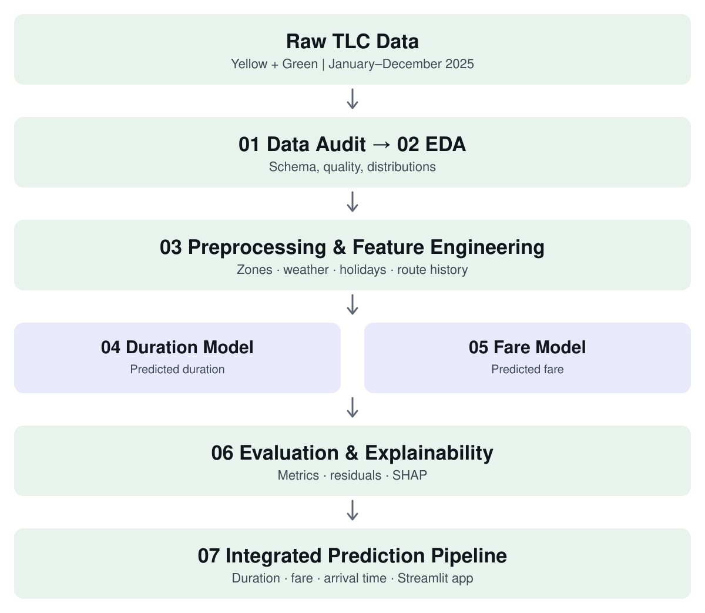

<div align="center">


<br/>


**How long will this ride take, and what will it cost?**
A two-stage machine learning pipeline and interactive React application built on
**2025** NYC TLC trip records. The app estimates trip duration from pre-trip
information, then predicts the metered fare using that estimated duration.

[Status](#status) · [Pipeline](#pipeline) · [Data](#data) · [No peeking](#no-peeking-at-the-future) · [Web app](#web-application-quickstart) · [Analysis](#machine-learning-quickstart)

</div>

---

## What the project predicts

| Stage | Target | Inputs | Output |
|:--:|---|---|---|
| **1** | `duration_min` | pickup time, pickup and drop-off zone, taxi type, geometry, weather, holiday flags, leakage-safe route history | minutes |
| **2** | `fare_amount` | everything in stage 1 **plus the stage-1 duration prediction** and historical fare aggregates | USD |

Both stages use only information available **before** the trip starts. Everything is done in one notebook,
[`notebooks/nyc_taxi_trip_duration.ipynb`](notebooks/nyc_taxi_trip_duration.ipynb).

**Research question:** does knowing the taxi type (Yellow or Green) improve duration predictions, and does a
model trained on one fleet work on the other?

## Status

Status of the final notebook and project components:

| § | Section | State |
|:--:|---|---|
| **1** | **Problem Formulation & Setup** (Environment, dependencies, hardware checks) | **Complete & Executed** |
| **2** | **Raw Data Audit & Integrity** (DuckDB inspection across 49.3M raw TLC records) | **Complete & Executed** |
| **3** | **Cleaning & Quality Waterfall** (Multi-stage filtering yielding 45.1M clean trips) | **Complete & Executed** |
| **4** | **Exploratory Data Analysis** (Spatiotemporal dynamics & 80:1 Yellow vs Green disparities) | **Complete & Executed** |
| **5** | **Feature Engineering & Pre-Trip Guardrails** (Hourly weather, holidays, leakage-free history) | **Complete & Executed** |
| **6** | **Chronological Partitioning & Sampling** (Train Jan–Aug, Val Sep–Oct, Test Nov–Dec) | **Complete & Executed** |
| **7** | **Stage 1: Trip Duration Model** (Baselines, ML suite, SHAP beeswarm, learning curve, fleet transfer) | **Complete & Executed** (Test MAE: **4.63 min**) |
| **8** | **Stage 2: Metered Fare Model** (Forward-pass duration integration, upper bound, SHAP, learning curve) | **Complete & Executed** (Test MAE: **$5.04**) |
| **9** | **System Integration & Pipeline Evaluation** (End-to-end two-stage serving & error propagation) | **Complete & Executed** |
| **10** | **Limitations & Edge Cases** (Residual anomalies, airport flat rates, out-of-distribution extremes) | **Complete & Executed** |
| **11** | **Conclusion & Responsible AI** (Fairness audit across boroughs, deployment recommendations) | **Complete & Executed** |
| **—** | **React Web Application** (`frontend/` + FastAPI model service in `api/`) | **Complete & Verified** |

**Split:** train Jan–Aug · validation Sep–Oct · test Nov–Dec 2025 (strict chronological, no shuffling).  
**Models:** Median and route-history baselines, Linear Regression, Decision Tree, Random Forest, HistGradientBoosting, LightGBM, XGBoost, and FAISS KNN.  
**Official Metrics:** MAE (primary), RMSE, $R^2$, and MedAE, reported overall and per taxi fleet. All 81 cells executed with zero errors.

## Pipeline



External inputs — the TLC zone lookup and shapefile, hourly weather, and the holiday calendar — enter
during feature engineering, together with the leakage-safe route and fare history built from earlier months only.

## Data

Official [TLC Trip Record Data](https://www.nyc.gov/site/tlc/about/tlc-trip-record-data.page) for
calendar year **2025**, Yellow and Green taxis:

| | Yellow | Green | Total |
|---|---:|---:|---:|
| Raw rows (Jan–Dec 2025) | 48,722,602 | 591,375 | 49,313,977 |
| Used for modelling | 44,511,782 (91.4%) | 559,224 (94.6%) | 45,071,006 |

Plus the TLC zone lookup and shapefile, hourly weather for Central Park from the Open-Meteo
archive, and the 2025 US federal and New York State holiday calendars. Standard FHV records are
excluded because they lack the pickup/drop-off and fare fields this task needs.

Every monthly file is downloaded by a restartable script that validates the Parquet footer, records a
SHA-256 and row count in `data/raw/manifest_2025.json`, and skips files that are already valid.
Nothing is assumed about availability: all 24 files were verified live before the pipeline was written.

## Two very different fleets


Yellow outnumbers Green by roughly **80 to 1** and concentrates in Manhattan and at the airports.
Green cabs (Boro Taxis) cannot take street hails in most of Manhattan and mostly serve the outer
boroughs, which is why every result in this project is reported per taxi type rather than pooled.

## No peeking at the future

| Allowed before the trip | Excluded (only known after it) |
|---|---|
| Pickup hour, day, month, weekend, rush hour, holiday | Drop-off timestamp, actual duration |
| Pickup & drop-off zone, borough, zone centroids | Metered `trip_distance` |
| Haversine and grid distance from zone geometry | `fare_amount`, `tip_amount`, `total_amount` |
| Weather at the pickup hour, taxi type | Tolls, surcharges, `congestion_surcharge`, `cbd_congestion_fee` |
| Route/zone history built from **earlier months only** | `RatecodeID`, `payment_type`, `store_and_fwd_flag` |

Two consequences worth stating plainly: expected duration accuracy is modest, because the model
never sees the route actually driven; and fare predictions must combine a metered fare estimate with
history, because tips and tolls are unknowable in advance.

## Repository layout

```text
nyc-taxi-ml/
├── api/                      FastAPI prediction and taxi-zone endpoints
├── app/                      legacy Streamlit prototype (not the deployed app)
├── assets/                   README graphics and hero illustration
├── data/
│   ├── raw/                  (git-ignored) monthly TLC Parquet files (~800 MB)
│   ├── processed/            (git-ignored) full cleaned 2025 parquet (1.6 GB)
│   └── external/             (tracked) hourly 2025 weather, centroids and holiday calendar
├── notebooks/
│   └── nyc_taxi_trip_duration.ipynb   fully executed master notebook (all outputs & plots saved)
├── outputs/
│   ├── figures/              (tracked) 16 official evaluation and diagnostic plots
│   ├── lookup/               (tracked) fast runtime spatial lookup parquets
│   └── models/               (tracked) trained duration & fare LightGBM models + feature schemas
├── scripts/                  get_data.py (download), export_serving_artifacts.py (serving export)
├── frontend/                 React + TypeScript + Vite app (Vercel frontend)
├── src/serving/              predictor.py (two-stage inference engine)
├── tests/                    serving and FastAPI endpoint tests
├── vercel.json               Vercel Services routing for frontend + API
└── docs/
    └── PROJECT_DOCUMENTATION.md       exhaustive technical report & architecture documentation
```

## Machine-learning quickstart

Requires [uv](https://docs.astral.sh/uv/) and Python **3.14 or newer**. The raw
trip data is not in Git; download it only if you intend to rerun the analysis:

```bash
git clone https://github.com/Shreyit/nyc-taxi-ml.git
cd nyc-taxi-ml
uv sync --extra analysis
uv run python scripts/get_data.py
```

The downloader fetches 24 monthly files plus zone data into `data/raw/`. Run the
analysis from [`notebooks/nyc_taxi_trip_duration.ipynb`](notebooks/nyc_taxi_trip_duration.ipynb)
using the project environment. Running the analysis is not required to launch
the app: the serving models and lookup tables are already in `outputs/`.

## Web application quickstart

The app is a React + TypeScript single-page frontend and a separate FastAPI
model service. The app guides a rider through pickup/drop-off zones, departure
date and time, and taxi fleet selection, then compares predictions for both
fleets. Its fixed OpenStreetMap view draws a straight line between zone
centroids; it is **not** a road route or turn-by-turn navigation. Predictions
come from the tracked LightGBM serving artifacts, not a browser-side formula.

Prerequisites: Python 3.14+ with `uv`, and Node.js 22.12+ with npm. From the
repository root, start the API in one terminal:

```bash
uv run uvicorn api.main:app --reload
```

In another terminal, install frontend dependencies and start Vite:

```bash
cd frontend
npm ci
npm run dev
```

Open the URL Vite prints (normally `http://localhost:5173`). In local
development, Vite forwards `/api` requests to `http://127.0.0.1:8000`. The API
loads `outputs/models/` and `outputs/lookup/` when it starts; no raw trip
downloads are needed. Interactive API documentation is available at
`http://localhost:8000/docs`.

### API reference

| Method | Path | Purpose |
|---|---|---|
| `GET` | `/api/health` | Confirms the predictor initialized. |
| `GET` | `/api/zones` | Lists taxi-zone IDs, names, boroughs, and centroid coordinates. |
| `POST` | `/api/predict` | Returns selected-fleet and comparison-fleet estimates. |

Example request:

```json
{
  "pickup_zone": 132,
  "dropoff_zone": 230,
  "pickup_at": "2026-11-23T18:00:00",
  "taxi_type": "Yellow"
}
```

`taxi_type` must be `Yellow` or `Green`. A timezone-naive `pickup_at` is
interpreted as New York local time; an offset-aware timestamp is converted to
that timezone. The prediction response contains `selected` and `comparison`
objects, each with a duration and range, metered fare and range, zone names and
coordinates, and trip context flags. Fare estimates exclude tips, tolls,
airport fees, and other surcharges.

### Deployment

This repository is configured for one Vercel project using **Vercel Services**
and the **Container Runtime** (both currently Beta): the Vite frontend handles
`/`, and a Dockerized FastAPI service handles `/api/*`. The Vercel routing is
in [`vercel.json`](vercel.json); [`Dockerfile`](Dockerfile) installs the Linux
OpenMP runtime required by LightGBM and copies only the API, serving code, and
model/lookup artifacts. Research and notebook packages are in the `analysis`
extra. [`.dockerignore`](.dockerignore) and [`.vercelignore`](.vercelignore)
keep local datasets and environments out of build/deploy uploads. Raw trip
downloads are not required.

From the repository root, install the Vercel CLI and link this checkout to the
project (the CLI prompts for authentication and project selection):

```bash
npx vercel@latest login
npx vercel@latest link
```

Deploy a preview first, then production:

```bash
npx vercel@latest
npx vercel@latest --prod
```

Keep the Vercel project root at the repository root so it can read
`vercel.json`, the root `Dockerfile`, and frontend/API sources. Do not set the
root to `frontend/`; the services configuration selects each service root.
Leave `VITE_API_BASE_URL` blank: both services share the Vercel origin, and
the frontend calls `/api/...` through the service rewrite. The local Vite proxy
remains configured for development.

After deployment, verify `https://<deployment>/api/health` returns
`{"status":"ok"}`, `https://<deployment>/api/zones` returns the taxi-zone list,
and then submit a trip from `https://<deployment>/#model`. Same-origin calls
do not require CORS configuration. If you later split the services across
domains, set `VITE_API_BASE_URL` to the API origin and configure the API's
`CORS_ORIGINS` allowlist.

The backend container uses Python 3.14 and installs the Linux `libgomp1`
runtime required by LightGBM. Vercel Services and the Container Runtime are
currently Beta. Check the first deployment's build/runtime logs and verify the
health and prediction endpoints before sharing the production URL.

### Checks

From the repository root:

```bash
uv run python -m pytest tests/test_serving.py tests/test_api.py
npm --prefix frontend run lint
npm --prefix frontend run build
```

## Documentation

The complete, exhaustive technical documentation is consolidated in:

* 📄 **[`docs/PROJECT_DOCUMENTATION.md`](docs/PROJECT_DOCUMENTATION.md)**: Technical report covering the modeling study, data and leakage controls, evaluation, limitations, and the current React + FastAPI serving architecture.

## Responsible use

TLC records are public and de-identified, and locations are only given at taxi-zone level. The models
predict trip duration and fare; they do not explain *why* a trip is slow, so no causal claims are made.
Errors are reported by taxi type, pickup borough, hour and trip length, because areas with fewer trips may
receive less accurate predictions. These are estimates to support human
judgement, not a substitute for it.

---

<div align="center">
<sub>Data: <a href="https://www.nyc.gov/site/tlc/about/tlc-trip-record-data.page">NYC Taxi &amp; Limousine Commission</a> ·
Weather: <a href="https://open-meteo.com/">Open-Meteo</a> ·
Built for <i>Introduction to Machine Learning</i>, School of Analytics, TISS</sub>
</div>
