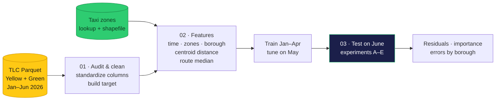

<div align="center">


<br/>


**How long will this ride take?** We predict NYC taxi trip duration using only what is known
when the trip starts (time and pickup/drop-off zones), and test whether
**Yellow** and **Green** taxis need different models.

[Research question](#research-question) ·
[Experiments](#experiments) ·
[Pipeline](#pipeline) ·
[Quickstart](#quickstart) ·
[Data](#data)

</div>

---

## Research question

> Can we predict NYC taxi trip duration using temporal and geographical features,
> and does incorporating taxi service type improve predictive performance?

| | |
|---|---|
| **Task** | Supervised regression |
| **Target** | `trip_duration_minutes = dropoff_datetime − pickup_datetime` |
| **Data** | NYC TLC Yellow & Green trip records, Jan–Jun 2026 |
| **Split** | Chronological: Jan–Apr train · May validation · June test |
| **Metrics** | MAE · RMSE · R² · Median AE (all in minutes, except R²) |
| **Models** | Median baseline → Linear Regression → Decision Tree → Random Forest → HistGradientBoosting |

## Two very different fleets


- **Yellow cabs** are concentrated in Manhattan and at the airports.
- **Green cabs** (Boro Taxis) can't take street hails in most of Manhattan and mostly serve the outer boroughs.

This makes the cross-service experiments interesting: a model trained on one fleet
is tested on parts of the city it has rarely seen.

## Experiments

| ID | Train on | Test on | What it tells us |
|:--:|---|---|---|
| **A** | Yellow | Yellow | Yellow-specific performance |
| **B** | Green | Green | Green-specific performance |
| **C1** | Yellow + Green | Yellow + Green | Combined model **with** `taxi_type` |
| **C2** | Yellow + Green | Yellow + Green | Combined model **without** `taxi_type` |
| **C3** | Yellow + Green balanced | Yellow + Green | Does the 90:1 imbalance matter? |
| **D** | Yellow | Green | Cross-service generalization |
| **E** | Green | Yellow | Cross-service generalization |

> [!IMPORTANT]
> **C1 vs C2 answers the research question.** Same rows, same model, same test set.
> The only difference is whether the model knows which taxi type it is.

## Pipeline



## No peeking at the future

The model may only use information available **when the trip begins**.

| Allowed | Excluded (known only after the trip) |
|---|---|
| Pickup hour, day of week, month, weekend, rush hour | Drop-off time, actual duration |
| Pickup & drop-off zone (and borough) | Actual `trip_distance` |
| Zone-centroid distance (pre-trip estimate) | Fare, tip, tolls, total, fees & surcharges |
| Route median duration (from **training months only**) | Payment type, `RatecodeID` |
| Passenger count (if reliable), taxi type | |

## Quickstart

Requires [uv](https://docs.astral.sh/uv/).

```bash
git clone https://github.com/Shreyit/nyc-taxi-ml.git
cd nyc-taxi-ml
uv sync                 # create .venv with all dependencies
```

Then select the project's `.venv` interpreter / Jupyter kernel in VS Code, and run the notebooks **in order**:

| # | Notebook | Does |
|:--:|---|---|
| 1 | `notebooks/01_data_preparation_eda.ipynb` | Audit, clean, EDA → `data/processed/` |
| 2 | `notebooks/02_feature_engineering_modeling.ipynb` | Features, training, saved models |
| 3 | `notebooks/03_evaluation_comparison.ipynb` | June test evaluation & comparisons |

## Data

Raw data is **not tracked in Git** (`data/` is in `.gitignore`). Download it from the
[TLC Trip Record Data page](https://www.nyc.gov/site/tlc/about/tlc-trip-record-data.page):

<details>
<summary><b>Download commands</b></summary>

```bash
mkdir -p data/raw/yellow data/raw/green data/processed
BASE=https://d37ci6vzurychx.cloudfront.net

for m in 01 02 03 04 05 06; do
  curl -fL -o data/raw/yellow/yellow_tripdata_2026-$m.parquet $BASE/trip-data/yellow_tripdata_2026-$m.parquet
  curl -fL -o data/raw/green/green_tripdata_2026-$m.parquet   $BASE/trip-data/green_tripdata_2026-$m.parquet
done

curl -fL -o data/raw/taxi_zone_lookup.csv $BASE/misc/taxi_zone_lookup.csv
curl -fL -o data/raw/taxi_zones.zip       $BASE/misc/taxi_zones.zip
```

</details>

```text
nyc-taxi-ml/
├── assets/                 README graphics
├── data/                   (git-ignored)
│   ├── raw/
│   │   ├── yellow/         yellow_tripdata_2026-01 … 06.parquet
│   │   ├── green/          green_tripdata_2026-01 … 06.parquet
│   │   ├── taxi_zone_lookup.csv
│   │   └── taxi_zones.zip
│   └── processed/          cleaned datasets from notebook 01
├── notebooks/              01 → 02 → 03
├── outputs/figures/        saved plots
├── src/utils.py            shared helpers
├── NYC_Taxi_ML_Project_Brief.md
└── ML_Mini_Project_Guidelines.pdf
```

## Responsible use

TLC trip records are public and de-identified, and locations are given only at taxi-zone level.
The models **predict** duration; they don't explain *why* trips are slow, so we avoid
causal claims. We also check whether errors differ across boroughs, because
areas with fewer trips may get less accurate predictions. See the
[project brief](NYC_Taxi_ML_Project_Brief.md#7-evaluation-and-reporting) for details.

---

<div align="center">
<sub>Data: <a href="https://www.nyc.gov/site/tlc/about/tlc-trip-record-data.page">NYC Taxi &amp; Limousine Commission</a> ·
Built for <i>Introduction to Machine Learning</i>, School of Analytics, TISS</sub>
</div>
